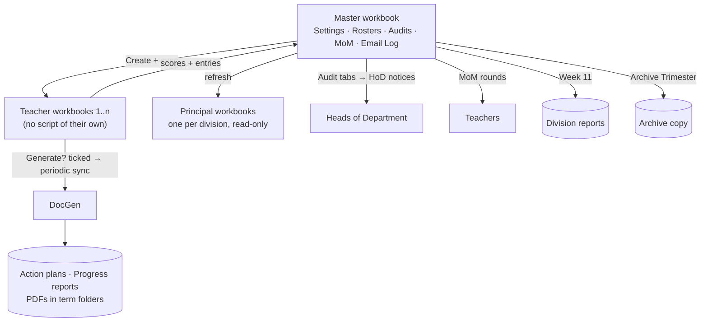
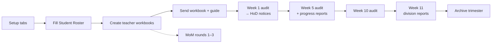

# Remedial Program Action Center

-8E75B2)

A complete Google Workspace system for running a school's **student intervention and prevention (remedial) program** across a full term. It covers everything from the student roster and per-teacher workbooks to bilingual action plans, progress reports, audits, Heads of Department communication, principal dashboards and end-of-term archiving.

It's built around one **master workbook** for the program lead. From it, the system generates and syncs a **workbook for every remedial teacher** and a **read-only workbook for each division principal**.

> **Impact:** One review round covers **76 action plans** for **56 students**, written by **33 teachers**. Reviewing them by hand took about **a week**; with the automated audit tabs, placeholder and generic-entry detection, and batched Head of Department notices, the same review now takes **about 15 minutes**.

---

## Screenshots

> Illustrations generated by running the project's real code against **fictional sample data**. No real school, staff or student data is included.

📖 **[Read the full illustrated guide](docs/GUIDE.md)**: every screen, tab, menu item, dialog and email, explained.

**Master dashboard: live cards for students, divisions, documents and teacher status**

**Student Roster: program, tier, assigned teachers and document links**

**Teacher workbook, Week 1: tick Generate? and the action plan is created**

**Email preview: every send is reviewed first**

### Menus

**Menus 1–4**

**Menus 5–7**

## Features

**Roster and tracking**
- **Student Roster** for Intervention and Prevention students, with tier, subjects, assigned teachers and document links. It can be locked to owner-only editing.
- **Teacher Roster**, derived automatically from the Student Roster, with links to each teacher's folder and workbook.
- **Scores Progress**: attendance and cumulative scores pulled from every teacher workbook, plus a final score entered by the program lead.
- **Remedial Attendance**: teacher punctuality grid for Weeks 2–10, grouped by division and subject.
- **Dashboard**: 7 color-coded cards (live formulas plus refreshable attendance data).

**Teacher workbooks**
- One spreadsheet per teacher with Profile, Week 1, Week 5, Week 10 and Progress Report Entries tabs.
- Two protected zones on each tab: lead-only notes and teacher-editable entries.
- **"Generate?" checkboxes**: when a teacher ticks one, a single time-driven sync trigger generates the document within about 15 seconds. This stays within Google's 20-trigger limit regardless of how many teachers there are.

**Documents**
- **Action Plans** (Phase 1 and 2) filled into English or Arabic Google Docs templates, with weekly scores, written summaries and **embedded charts**, then exported as PDFs.
- **Progress Reports** assembled from each subject teacher's confirmed entries, with N/A for subjects the student isn't enrolled in.
- **Division Reports**: one PDF per division with grouped bar charts comparing students in the same subject and grade.
- **Probation letters**: signed copies are uploaded and linked to the student's row.
- **Minutes of Meeting**: three rounds per term. Generating and sending are separate steps.
- Each term's documents are filed into their own term folder automatically.

**Audits and communication**
- Tab-by-tab **audits** (Week 1, Week 5 with Progress Report entries, Week 10) of every teacher workbook.
- **Template alignment check** for generated action plans.
- **Generic-entry detection**: a phrase blocklist and length rules, plus an optional **Gemini API** judgment for borderline entries. Nothing is emailed without the lead's approval.
- Emails to HoDs about missing entries and deadlines, thank-you emails for flawless tabs, and deadlines to teachers with HoDs and principals in CC.
- **Every email is previewed** with its recipients, CC, subject and body before anything is sent, and every send is logged.

**Principal workbooks**
- One read-only workbook per division showing today's remedial schedule, a green/red attendance grid and missing-document counts.

**End of term**
- **Archive Trimester** copies the master workbook to an archive folder and clears live data while keeping settings.

## Architecture

### Term workflow

| Area | Files |
|---|---|
| Menus, audits, HoD communication | `Code.gs`, `AUDIT_HOD.gs` |
| Configuration | `Config.gs`, `Setup_Settings.gs` |
| Tab builders | `Setup_*.gs` |
| Teacher workbooks and sync | `TeacherWorkbook.gs`, `TeacherWorkbookTriggers.gs` |
| Document generation | `DocGen.gs`, `ActionPlanFill.gs`, `ProgressReportAssemble.gs`, `DivisionReport.gs`, `ProbationLetter.gs`, `UploadDialog.html` |
| Email | `EmailFunctions.gs`, `Setup_EmailLog.gs`, `MoMCompose.html`, `MoMSendPreview.html` |
| Principals | `PrincipalsWorkbook.gs` |
| AI quality check | `GenericEntryCheck.gs` |
| Archive | `Archive.gs` |

## Setup

1. Create a Google Sheet for the master workbook. Open **Extensions → Apps Script** and add every file from `src/`.
2. Reload the sheet. From menu **1. Setup**, build each tab, starting with **Build Settings Tab**.
3. Fill in **Settings**:
   - contacts (Academic Dean, principals, directors) with an *Active* flag
   - term number and term start date
   - Drive **folder IDs** for action plans, progress reports, probation letters, MoM, archive, teacher workbooks and principal workbooks
   - Google Docs **template IDs** for the action plan (English and Arabic), progress report and MoM
4. Set the sample `TERM_START_DATES` in `Config.gs` to your school calendar.
5. Fill in the **HoD Directory** with the Head of Department for each subject.
6. Add students to the **Student Roster**. Then use menu **2. Teachers & Principals** to create teacher workbooks and send teachers their links.
7. Run **7. System & End of Term → Install Periodic Sync (run once)**.
8. *(Optional)* Add a `GEMINI_API_KEY` in **Project Settings → Script Properties** to turn on AI review of borderline generic entries. Without it, only rule-based checks run.

> **Template note:** `ActionPlanFill.gs` writes into fixed table positions in the action-plan template. If you change the template's table layout, re-map the indices at the top of that file.

## Privacy and security

- The repository contains **no student data, names, emails, Drive IDs or API keys**.
- **6. Student Roster & Probation → Protect Student Data** locks the Student Roster to owner-only editing.
- The API key is read only from Script Properties, never from code.
- Generated documents are shared at organization level by default.

## License

[MIT](LICENSE) © Randa ELGawish

## Author

**Randa ELGawish**, Academic leader and EdTech developer
[LinkedIn](https://www.linkedin.com/in/randaelgawishegy) · [GitHub](https://github.com/RandaELGawish93)
